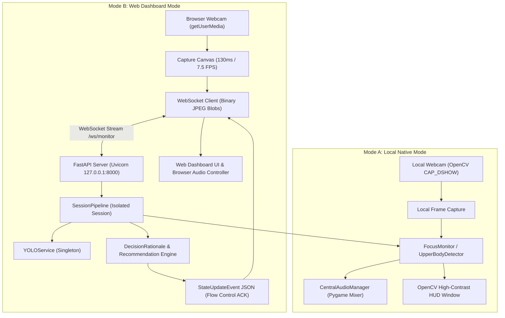
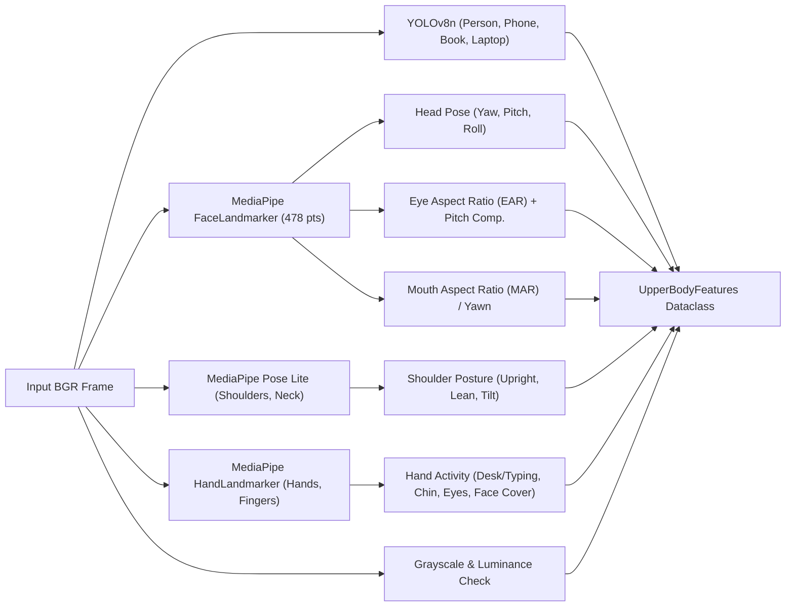
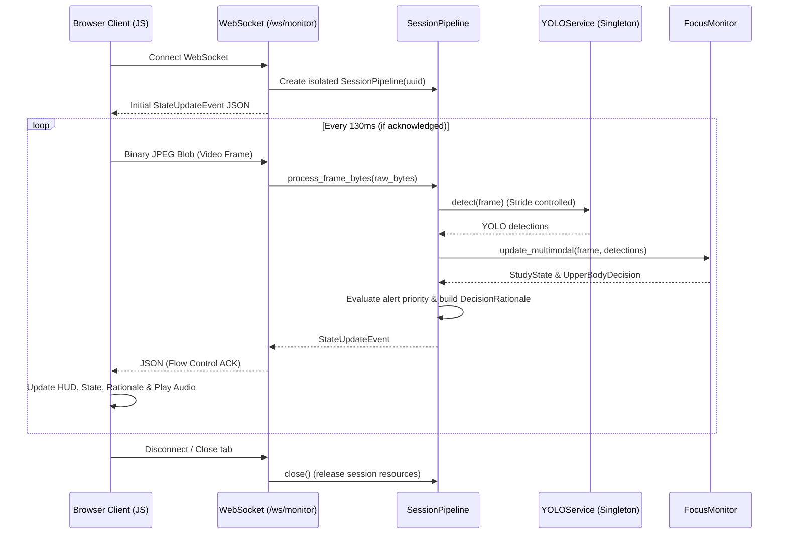

# System Architecture — AI Study Focus Monitor

This document details the software architecture, pipeline decomposition, data flows, and communication protocols for the AI Study Focus Monitor.

---

## 1. High-Level System Architecture

The system supports two independent execution modalities: **Mode A (Local Native)** and **Mode B (Web Dashboard)** sharing the underlying core perception engine.



---

## 2. Multi-Model Perception Pipeline

The perception pipeline extracts upper-body signals from a webcam frame across four independent vision models and spatial algorithms.



### Perception Models Breakdown
1. **Ultralytics YOLOv8n:**
   * Weights: `yolov8n.pt`
   * Target classes: `0: person`, `67: cell phone`, `73: book`, `63: laptop`.
   * Execution stride: Configured via `YOLO_INFERENCE_STRIDE = 1`. Caches detections across skipped frames to avoid timer resets.
2. **MediaPipe FaceLandmarker:**
   * Model task: `face_landmarker.task`
   * Key outputs: 478 3D landmarks, iris keypoints, outer/inner lip landmarks.
   * `cv2.solvePnP` uses 6 canonical 3D facial feature points (nose tip, chin, eye corners, mouth corners) to solve for 3D rotation vectors (`head_yaw`, `head_pitch`, `head_roll`).
3. **MediaPipe PoseLandmarker (Lite):**
   * Model task: `pose_landmarker.task`
   * Extracts landmarks 11 (left shoulder) and 12 (right shoulder) to calculate shoulder tilt, torso rotation, and vertical slouch relative to baseline.
4. **MediaPipe HandLandmarker:**
   * Model task: `hand_landmarker.task`
   * Detects 21 3D joint landmarks per hand. Computes intersection-over-union (IoU) with the face/head box and proximity to the lower camera boundary.

---

## 3. Decision-Making & State Pipeline

The system decouples raw observations from temporal arbitration and alert eligibility:

```
Camera Frame ──► UpperBodyDetector ──► IndependentObservations
                                              │
                                              ▼
                                   TemporalDecisionEngine
                                  (Duration Timers & Hysteresis)
                                              │
                                              ▼
                                      StudyState Decision
                                              │
                                              ▼
                                     Alert Controller
                                  (Priority & Cooldown)
                                              │
                                              ▼
                                 UI Update & Audio Playback
```

### Pipeline Stages
1. **Feature Extraction (`UpperBodyDetector`):**
   * Extracts physical landmarks, head angles, EAR, MAR, motion magnitude.
   * Formats into `UpperBodyFeatures` with structured `IndependentObservations`.
2. **Temporal Decision Engine (`TemporalDecisionEngine`):**
   * Evaluates instantaneous active behaviors (`Set[BehaviorLabel]`).
   * Accumulates monotonic timers for sustained conditions (`_phone_start`, `_absence_start`, `_occlusion_start`, `_inactivity_start`, `_eye_closed_start`, `_head_down_start`).
   * Applies rolling consensus smoothing (`SMOOTHING_WINDOW_SECS = 0.5s`) for non-alert states.
   * Enforces recovery stability window (`RECOVERY_STABILITY_SECS = 1.2s`) before transitioning back to clean study.
3. **State Mapping (`FocusMonitor` / `state_machine.py`):**
   * Translates internal `BehaviorLabel` candidates to explicit authoritative `StudyState`.
   * Distinguishes `DISTRACTED` (phone off-task), `LOOKING_AWAY` (room scanning/gaze drift), and `INACTIVITY_WARNING` (idle camera staring).
4. **Alert Arbitration (`CentralAudioManager` / `SessionPipeline`):**
   * Checks alert eligibility, priority hierarchy, and cooldown (`ALERT_COOLDOWN_SECONDS = 15.0s`).
   * Enforces immediate audio cutoff on recovery to clean study.

---

## 4. Web Mode Architecture & Real-Time Protocol

### 4.1 FastAPI Backend Architecture
* **Server Root:** `app/main.py` (FastAPI instance served via Uvicorn).
* **Static Assets:** Serves `frontend/` static HTML/CSS/JS and `assets/audio/` alert sound clips.
* **YOLO Service Singleton:** `app/yolo_service.py` maintains a single thread-safe YOLOv8 model instance in GPU/CPU memory shared across sessions.
* **Isolated Session Pipeline:** `app/session_pipeline.py` allocates an independent instance of `FocusMonitor` per client WebSocket connection.

### 4.2 Flow-Controlled WebSocket Protocol
To eliminate frame backlog and prevent unbounded latency growth:
* Client captures a frame from browser canvas as a JPEG blob.
* Client checks `isAwaitingAck`: if a prior frame is still processing on the server, the new frame is dropped.
* Server decodes JPEG, executes inference, constructs `StateUpdateEvent`, and responds with JSON.
* Receiving the JSON response clears `isAwaitingAck` on the client, pacing transmission to exact inference throughput (~7.5–10 FPS).



---

## 5. Module Dependency Graph

```
run_app.py
 ├── Mode A: run_webcam_yolo.py
 │    ├── focus_monitor.py
 │    │    ├── upper_body_detector.py ──► behavior_types.py
 │    │    ├── temporal_decision_engine.py ──► behavior_types.py
 │    │    └── state_machine.py
 │    ├── audio_alerts.py ──► config.py
 │    └── logger.py
 └── Mode B: app/main.py (FastAPI)
      ├── app/session_pipeline.py
      │    ├── focus_monitor.py
      │    ├── app/yolo_service.py ──► config.py
      │    ├── app/recommendation_engine.py
      │    └── app/schemas.py (Pydantic models)
      └── frontend/ (Vite / Vanilla JS)
           ├── js/camera_manager.js
           ├── js/websocket_client.js
           ├── js/audio_controller.js
           └── js/app.js
```

---

## 6. Resource Lifecycle & Clean Shutdown
* **Webcam Resources:**
  * Mode A: OpenCV `cv2.VideoCapture` is closed in the `finally:` block of `run_webcam_yolo.py`.
  * Mode B: Browser media tracks (`MediaStreamTrack.stop()`) are halted on session stop, tab refresh, or window unload.
* **Model Tasks:**
  * MediaPipe landmarker instances (`_face_landmarker`, `_pose_landmarker`, `_hand_landmarker`) provide `.close()` methods to release native C++ buffers cleanly.
* **Audio Channels:**
  * Pygame mixer stops all sound channels on exit. Web Audio elements are paused and reset to 0 timestamp upon stopping.

