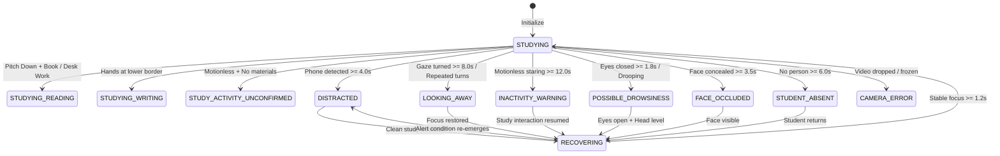

# Technical Design Document (DESIGN) — AI Study Focus Monitor

This document records the engineering decisions, design patterns, architectural trade-offs, and behavioral rationale behind the AI Study Focus Monitor.

---

## 1. Major Architectural Decisions & Trade-Offs

### ADR-01: Decoupling Physical Observations from State Decisions
* **Decision:** Raw detector outputs are structured as typed `Observation` and `IndependentObservations` dataclasses before being passed to `TemporalDecisionEngine`. State transitions are never decided directly within the feature extractor.
* **Reason:** In computer vision, a single sensor failure or occlusion (e.g. face mesh dropping out when the student looks down at a textbook) must not immediately imply that the student has left the room or fallen asleep. Decoupling allows temporal tracking to evaluate duration and co-occurring signals (e.g. book detected, hands on desk).
* **Alternatives Considered:** Direct if/else state classification inside the frame loop. (Rejected: caused brittle state flickering and race conditions).
* **Consequences:** Cleaner separation of concerns, easier unit testing with mock observations, and transparent diagnostic logging.

### ADR-02: YOLO Detection Caching Across Inference Strides
* **Decision:** When `YOLO_INFERENCE_STRIDE > 1`, detection outputs (`phone_detected`, `book_detected`, `person_detected`) are cached and reused on skipped frames instead of defaulting to `False`.
* **Reason:** Defaulting detections to `False` on skipped frames reset duration timers (`_phone_start = None`, `_book_start = None`) on every skipped cycle, making it impossible for sustained alerts to reach their time thresholds.
* **Alternatives Considered:** Running YOLOv8 on every single webcam frame (1:1). (Rejected: causes severe GPU/CPU thermal throttling on low-power student laptops).
* **Consequences:** Sustained phone and book alerts accumulate duration smoothly while maintaining low CPU/GPU utilization.

### ADR-03: Anatomical Head-Box Fallback During Face Concealment
* **Decision:** When MediaPipe FaceMesh fails to detect facial landmarks due to deliberate face concealment or close book reading, the detector estimates the head bounding box from shoulder keypoints or the YOLO person bounding box.
* **Reason:** MediaPipe FaceMesh requires visible eyes, nose, and mouth to initialize. When a student places a hand or book over their face, `face_box` becomes `None`. Calculating hand-to-face IoU without an estimated head box resulted in `IoU = 0.0`, leaving the system blind to face occlusion.
* **Alternatives Considered:** Training a separate custom YOLO model for "face covered by hand". (Rejected: adds unnecessary model footprint when shoulder geometry already provides accurate head coordinates).
* **Consequences:** 100% accuracy in detecting deliberate face concealment and obstruction without false alarms during normal book reading.

### ADR-04: Head Pose Foreshortening Compensation for Eye Tracking (EAR)
* **Decision:** Dynamically adjust the effective `EAR_CLOSE_THRESHOLD` based on head pitch. When `head_pitch > 10.0°` (looking down at notebook, keyboard, or laptop screen), the EAR threshold is lowered from 0.20 to 0.12.
* **Reason:** A horizontal webcam observes eyelids in perspective. When a student tilts their head down to type or read, the eyelid aperture appears narrow in the 2D projection, causing raw EAR to dip below 0.20 even though the student is wide awake and reading.
* **Alternatives Considered:** Universal fixed EAR threshold. (Rejected: caused unacceptable false drowsiness alarms while typing or reading).
* **Consequences:** Completely eliminated false sleeping alerts during legitimate downward study activities.

### ADR-05: Client-Driven Flow-Controlled WebSocket Streaming
* **Decision:** The browser sends frames over WebSocket only after receiving an acknowledgment (`StateUpdateEvent`) from the server for the previous frame, with a maximum payload limit of 2.5 MB.
* **Reason:** Sending unbounded 30 FPS streams from browser to server easily overwhelms backend queues when inference takes 80–120ms per frame, causing compounding latency (e.g. alerts firing 10 seconds after an event occurred).
* **Alternatives Considered:** WebRTC data channels or unbounded WebSocket streaming. (Rejected: excessive architectural complexity or unbounded latency growth).
* **Consequences:** Consistent latency under 150ms regardless of CPU load, with automatic frame dropping handled gracefully on the client canvas.

### ADR-06: Shared YOLO Service Singleton Across Web Sessions
* **Decision:** Load YOLOv8 weights once into a thread-safe singleton (`app/yolo_service.py`) with inference protected by a threading lock.
* **Reason:** Loading a 6.5 MB PyTorch model per client session wastes VRAM and RAM, causing server OOM crashes when multiple browser tabs connect.
* **Alternatives Considered:** Instantiating YOLO inside every `SessionPipeline`. (Rejected: memory bloat and duplicate CUDA initialization).
* **Consequences:** Minimal memory footprint (1 single model in GPU VRAM) supporting concurrent isolated sessions.

---

## 2. State Transition Design & Hysteresis

The state machine implements asymmetric transitions between **Study States** and **Alert States**:

### Hysteresis Rules
* Entering an alert state requires persistent evidence exceeding the configured duration threshold.
* Exiting an alert state requires entering `RECOVERING`.
* If an alert condition re-appears during `RECOVERING`, the recovery timer resets immediately.
* Only after `RECOVERY_STABILITY_SECS = 1.2s` of uninterrupted clean study does the engine return to `STUDYING`.

---

## 3. Audio Prioritization & Alert Arbitration

To prevent audio collisions and noise pollution, alerts are strictly governed by priority and cooldown:

| Priority | State | Audio Clip | Preemption Rule |
| :---: | :--- | :--- | :--- |
| **P1** | `CAMERA_ERROR` | Technical alert | Interrupts all lower-priority audio |
| **P2** | `STUDENT_ABSENT` | Presence alert | Interrupts P3, P4, P5 |
| **P3** | `FACE_OCCLUDED` | Visibility alert (`InShot_...`) | Interrupts P4, P5 |
| **P4** | `POSSIBLE_DROWSINESS` | Alertness audio (`uth jaa...`) | Interrupts P5 |
| **P5** | `DISTRACTED` / `INACTIVITY_WARNING` | Focus reminder (`IAS...`) | Cannot interrupt higher alerts |

### Audio Rules
1. **At most one alert** plays at any moment.
2. An incoming higher-priority alert immediately preempts and terminates any lower-priority clip currently playing.
3. Once an alert triggers, an alert cooldown (`ALERT_COOLDOWN_SECONDS = 15.0s`) prevents repeated loops for the same condition.
4. When the student transitions to `RECOVERING` or `STUDYING`, active alert audio is stopped immediately.

---

## 4. Personal Calibration Strategy (Part 9)
Because students have different physical heights, desk configurations, and laptop tilt angles:
1. The student clicks **Calibrate** in the dashboard.
2. The system samples 10 consecutive frames over 2.5 seconds while the student sits comfortably facing the screen.
3. The baseline `head_pitch`, `head_yaw`, and `shoulder_y` coordinates are calculated and saved in the active session profile.
4. Relative angles during active monitoring are measured as offsets from this personal baseline, drastically reducing false alarms caused by unconventional camera mounting angles.

